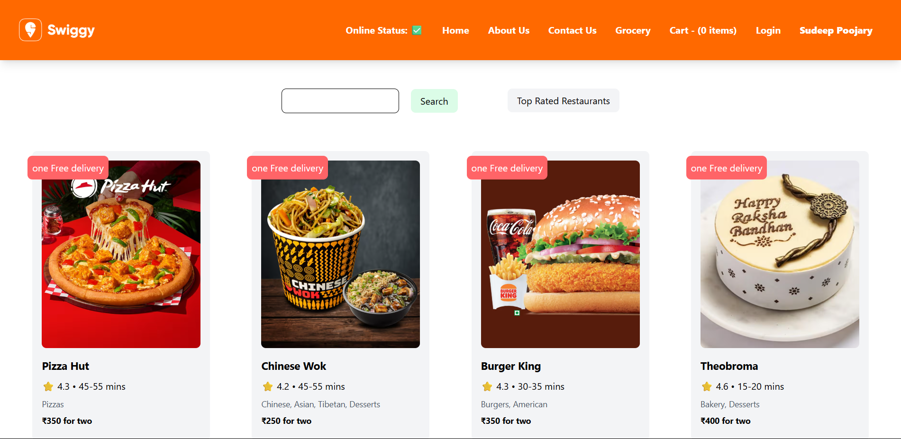
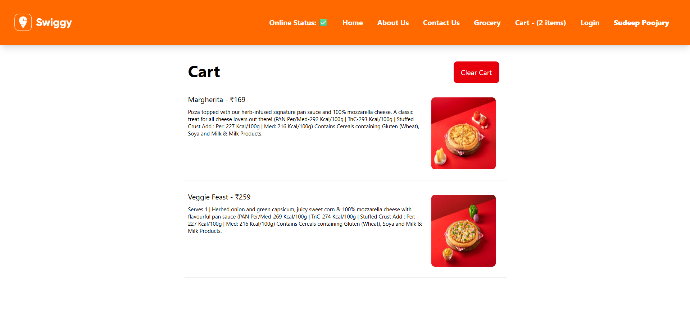

<h1 align = "center"> FeastFly </h1>

A Swiggy-style food ordering app built with React.

## Technologies 🛠️

- HTML, CSS, JavaScript
- React.js
- Parcel
- Tailwind CSS
- Context API
- Redux Toolkit
- React Testing Library
- Jest

## Getting Started 💻

1. Clone the repository

   ```bash
   git clone https://github.com/Sudeep-Poojary/FeastFly.git
   cd FeastFly
   ```

2. Install dependencies and start the dev server

   ```bash
   npm install
   npm start
   ```

   The app runs at <http://localhost:1234>. No browser extensions are needed.

3. Run the tests

   ```bash
   npm test
   ```

## Data 🍕

Restaurant and menu data comes from the [NamasteDev dummy API](https://namastedev.com/api/v1/listRestaurants), which returns Swiggy-shaped data:

- `GET /listRestaurants`: the restaurant list
- `GET /listRestaurantMenu/:id`: one restaurant's menu

If the API can't be reached (offline, blocked, or too slow), the app uses a bundled copy of the same dataset (`src/data/restaurants.js`), so it always has something to show.

## Deploy to Vercel 🚀

The repo includes a `vercel.json`, so it deploys as-is:

1. Import the GitHub repo in [Vercel](https://vercel.com/new).
2. Keep the defaults. `vercel.json` sets the build command (`npm run build`), the output folder (`dist`), and an SPA rewrite so links like `/restaurants/123456` work on refresh.

## Screenshots 📸

<div align="center">






</div>
