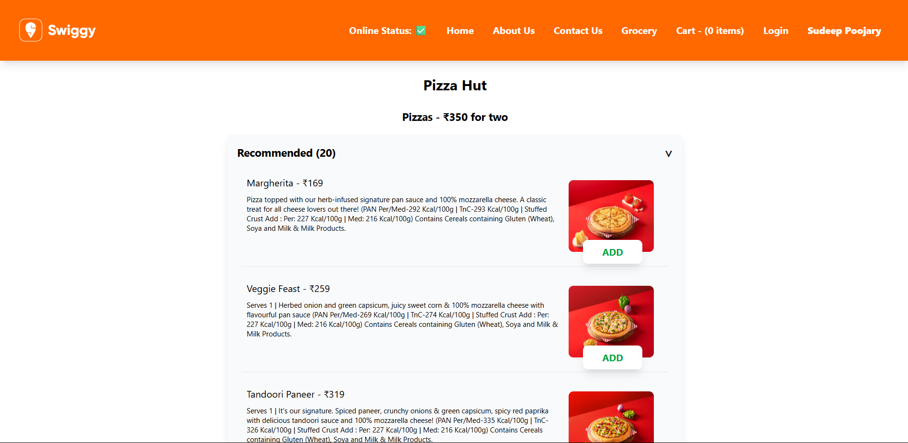

<h1 align = "center"> FeastFly </h1>

A Swiggy-style food ordering app built with React.

## Features ✨

- **Home:** "What's on your mind?" cuisine carousel, top-rated row, live search, sort, quick filters (fast delivery, 4.0+, pure veg, offers, under ₹300), and infinite scroll through 40 restaurants
- **Restaurant menu:** rating and delivery info, deals, dish search, a "Veg only" switch, collapsible categories, and ADD → quantity steppers
- **Cart:** one restaurant per cart (with a "replace cart?" prompt), a bill with delivery, platform fee and GST, and a cart that's saved across reloads
- **Also:** a FeastFly Mart (grocery) coming-soon page, an About page, a Help & Support page with FAQ and a validated contact form, a 404 page, an offline banner, and a mobile menu
- **Built for everyone:** responsive layouts, keyboard and screen-reader friendly controls, a skip link, page titles, and reduced-motion support

## Technologies 🛠️

- HTML, CSS, JavaScript
- React.js
- Parcel
- Tailwind CSS
- Context API
- Redux Toolkit
- React Testing Library
- Jest

## Getting Started 💻

1. Clone the repository

   ```bash
   git clone https://github.com/Sudeep-Poojary/FeastFly.git
   cd FeastFly
   ```

2. Install dependencies and start the dev server

   ```bash
   npm install
   npm start
   ```

   The app runs at <http://localhost:1234>. No browser extensions are needed.

3. Run the tests

   ```bash
   npm test
   ```

## Data 🍕

Restaurant and menu data comes from the [NamasteDev dummy API](https://namastedev.com/api/v1/listRestaurants), which returns Swiggy-shaped data:

- `GET /listRestaurants`: the restaurant list
- `GET /listRestaurantMenu/:id`: one restaurant's menu

If the API can't be reached (offline, blocked, or too slow), the app uses a bundled copy of the same dataset (`src/data/restaurants.js`), so it always has something to show.

The API returns 10 restaurants and has no pagination. To demo infinite scroll, the home page loads further pages from 30 extra restaurants that exist only in `src/data/moreRestaurants.js`.

## Deploy to Vercel 🚀

The repo includes a `vercel.json`, so it deploys as-is:

1. Import the GitHub repo in [Vercel](https://vercel.com/new).
2. Keep the defaults. `vercel.json` sets the build command (`npm run build`), the output folder (`dist`), and an SPA rewrite so links like `/restaurants/123456` work on refresh.

## Screenshots 📸

<div align="center">





</div>
